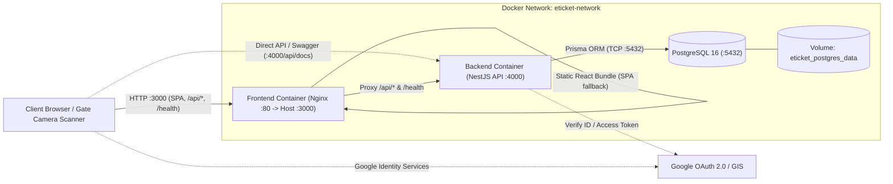
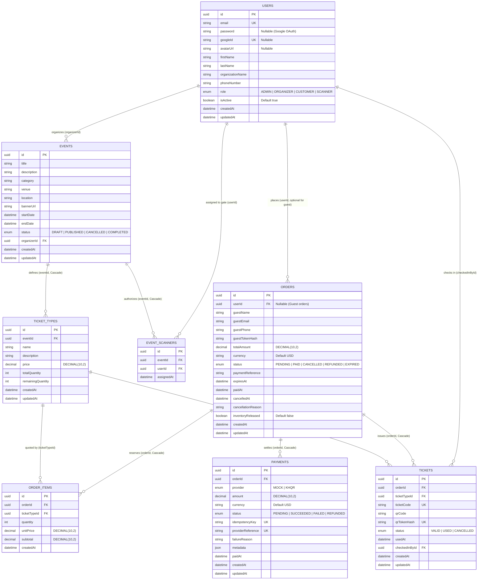
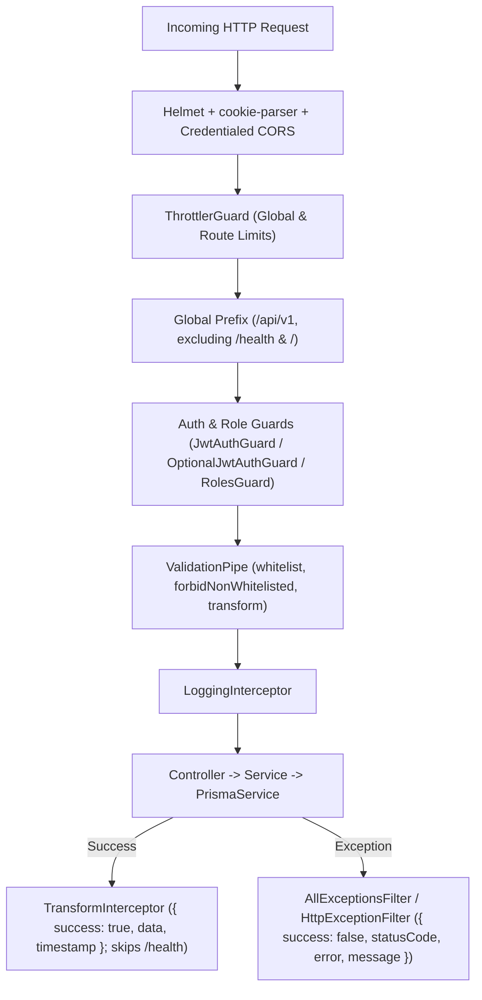
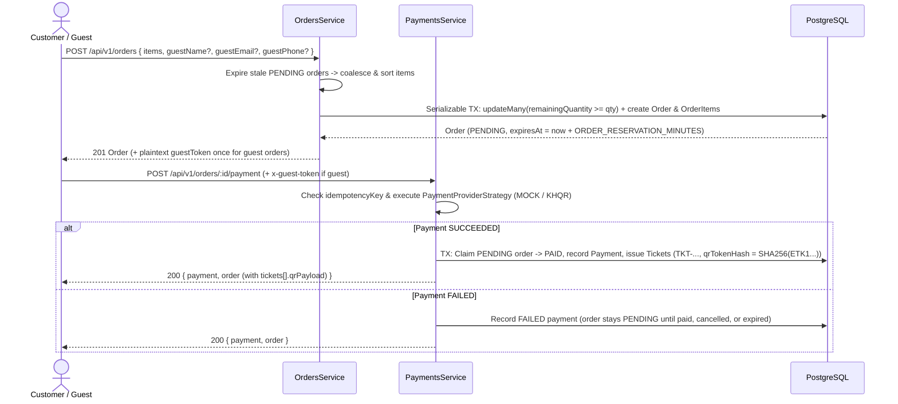
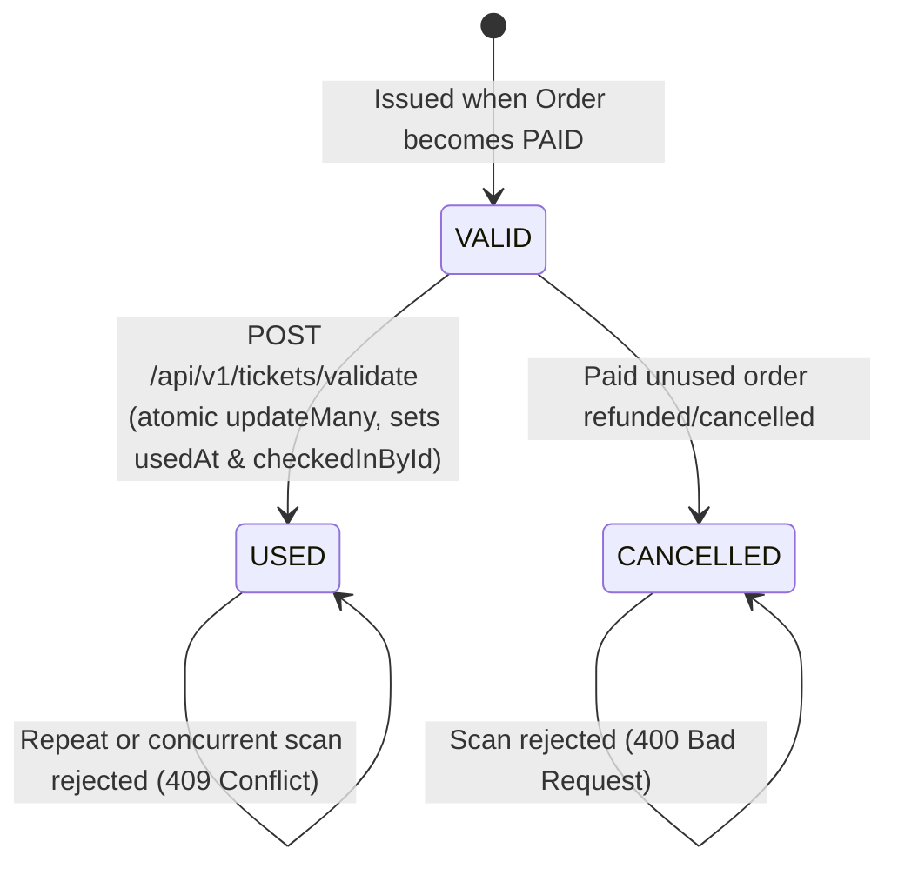

# System & Database Architecture — Universal E-Ticketing Platform

This document describes the end-to-end system architecture, PostgreSQL database schema, NestJS backend modules, React SPA workspace structure, and core runtime flows derived directly from the repository (`frontend/`, `backend/`, `infra/`, and `docker-compose.yml`).

---

## 1. High-Level System Architecture

The platform follows a containerized **3-tier client-server architecture** connected over an isolated Docker bridge network (`eticket-network`):

- **Presentation Tier (`frontend/`):** React 18.3 + TypeScript SPA built with Vite 6, React Router 6 (`BrowserRouter`), Tailwind CSS 3.4, GSAP, and Motion, served by **Nginx 1.27 Alpine** in production (or Vite Dev Server on port `5173` locally).
- **Application Tier (`backend/`):** Modular **NestJS 10** REST API exposing `/api/v1/*`, `/health`, `/`, and Swagger OpenAPI docs at `/api/docs`, secured with `helmet`, `cookie-parser`, `@nestjs/throttler`, dual `HttpOnly` cookie + Bearer JWT authentication, and optional Google OAuth 2.0 verification (`google-auth-library`).
- **Data Tier (`postgres`):** **PostgreSQL 16 Alpine** accessed exclusively through **Prisma ORM 5 (`@prisma/client`)**, backed by versioned SQL migrations (`backend/prisma/migrations/`) and persistent volume `eticket_postgres_data`.



### Runtime Environments

| Mode | Frontend Entry | Backend Entry | API Proxying |
|---|---|---|---|
| **Production (Docker Compose)** | `http://localhost:3000` (Nginx `:80`) | `http://localhost:4000` (`eticket-backend`) | Nginx proxies `/api/` and `/health` to `http://backend:4000` |
| **Local Development (Vite + Nest)** | `http://localhost:5173` (Vite Dev Server) | `http://localhost:4000` (`npm run start:dev`) | Vite dev proxy forwards `/api` and `/health` to `http://localhost:4000` |

---

## 2. Database Architecture & Schema Design

The database schema is defined in [`backend/prisma/schema.prisma`](../backend/prisma/schema.prisma) with three versioned migrations under `backend/prisma/migrations/`:
1. `20261121154357_upgrade_ticketing_lifecycle`
2. `20261121170000_add_google_oauth`
3. `20261121180000_add_guest_checkout_orders`

All primary keys use **UUID v4** (`@default(uuid())`) and monetary values use **`DECIMAL(10, 2)`** paired with integer minor-unit calculations (`backend/src/common/utils/money.util.ts`).

### 2.1 Entity-Relationship Diagram (ERD)



### 2.2 Table & Column Summary

- **`users` (`User`):** Stores platform accounts. `password` is nullable for Google OAuth accounts (`googleId` unique, `avatarUrl`). `isActive` supports account suspension.
- **`events` (`Event`):** Stores event metadata, schedule (`startDate`, `endDate`), `status` (`DRAFT`, `PUBLISHED`, `CANCELLED`, `COMPLETED`), and `organizerId`. Indexed on `[status, startDate]`, `[organizerId]`, and `[category]`.
- **`ticket_types` (`TicketType`):** Tier pricing (`DECIMAL(10,2)`) and inventory (`totalQuantity`, `remainingQuantity`). `remainingQuantity` represents unreserved, unsold tickets. Cascades on `Event` deletion.
- **`orders` (`Order`):** Supports both registered users (`userId`) and guest buyers (`guestName`, `guestEmail`, `guestPhone`, `guestTokenHash`). Tracks `status` (`PENDING`, `PAID`, `CANCELLED`, `REFUNDED`, `EXPIRED`), `expiresAt`, `paidAt`, `cancelledAt`, `cancellationReason`, and `inventoryReleased` (prevents double inventory release). Indexed on `[userId, createdAt]` and `[status, expiresAt]`.
- **`order_items` (`OrderItem`):** Snapshots `unitPrice`, `quantity`, and `subtotal` at reservation time before tickets are issued.
- **`payments` (`Payment`):** Tracks provider (`MOCK` | `KHQR`), `status` (`PENDING`, `SUCCEEDED`, `FAILED`, `REFUNDED`), unique `idempotencyKey`, unique `providerReference`, `failureReason`, and JSON `metadata`.
- **`tickets` (`Ticket`):** Issued after payment succeeds. Stores unique `ticketCode` (`TKT-...`), unique SHA-256 `qrTokenHash` (never storing the raw signed `ETK1.` token), `status` (`VALID`, `USED`, `CANCELLED`), `usedAt`, and `checkedInById` (FK to `users.id` with `SetNull`).
- **`event_scanners` (`EventScanner`):** Maps `SCANNER` users to authorized events (`@@unique([eventId, userId])`).

### 2.3 Seed Data Reference (`backend/prisma/seed.ts`)

Running `npm run prisma:seed` upserts deterministic development records:
- **Users** (all password `Password123!`):
  - `ADMIN`: `admin@eticket.com` (`a0000000-...-0000`)
  - `ORGANIZER`: `organizer@eticket.com` (`a0000000-...-0001`, *Cambodia Tech Events Ltd.*)
  - `CUSTOMER`: `customer@eticket.com` (`a0000000-...-0002`)
  - `SCANNER`: `scanner@eticket.com` (`a0000000-...-0003`)
- **Events:** 6 `PUBLISHED` events with local banner images under `frontend/public/banners/` (including *Cambodia Tech Expo & Music Festival 2026*, *Mekong Sunset Electronic Night*, *Angkor International Half Marathon*, *Southeast Asia Product & Design Summit*, *Khmer Culinary & Heritage Cinema Night*, and *Phnom Penh Stand-Up & Indie Live Special*), each with 2 ticket tiers and `EventScanner` access granted to `scanner@eticket.com`.
- **Order & Ticket:** `PAID` order `d0000000-...-0001` (`$99.00`, `MOCK-SEED-998822`) with `OrderItem`, `Payment` (`seed-payment-001`), and valid ticket **`TKT-2026-VIP-001`**.

---

## 3. Application Layer Architecture

### 3.1 Backend Module Architecture (`backend/src/`)

`AppModule` composes global configuration (`ConfigModule` + `env.validation.ts`), global rate limiting (`ThrottlerModule` / `ThrottlerGuard` at 200 req/min), global `PrismaModule`, and 8 domain modules:

| Module | Responsibility |
|---|---|
| `HealthModule` | `GET /health` executing `SELECT 1` latency check via `PrismaService.checkHealth()` |
| `AuthModule` | Cookie + Bearer JWT authentication, customer/organizer registration, Google OAuth 2.0 verification, `JwtAuthGuard`, `OptionalJwtAuthGuard`, `RolesGuard` |
| `EventsModule` | Paginated discovery (`QueryEventsDto`), category listing, owner/admin CRUD, deletion guard when orders/tickets exist |
| `TicketsModule` | Ticket tier CRUD (`POST`/`PATCH`/`DELETE`), customer wallet (`GET /my`), scanner event list, authorized inspection, atomic gate check-in (`POST /validate`) |
| `OrdersModule` | `Serializable` inventory reservation, guest token issuance/verification, lazy stale-order expiration, cancellation & unused-paid refunds |
| `PaymentsModule` | `PaymentProviderStrategy` (`MockPaymentProvider`, `KHQRPaymentProvider` stub), idempotency key replay, HMAC webhook handling, post-payment ticket issuance |
| `OrganizerModule` | Gross/refunded/net revenue metrics, sales series, event analytics, attendee/check-in lists, and team `SCANNER` account provisioning/assignment |
| `AdminModule` | Platform-wide KPIs, user list/creation/role/status updates (with self-demotion/suspension guards), global order & ticket monitors |

#### NestJS Request & Response Pipeline (`backend/src/main.ts`)



### 3.2 Frontend Application Architecture (`frontend/src/`)

The frontend SPA uses `BrowserRouter` and splits routes across three layout shells:

1. **Standalone Auth Pages** (no header/footer): `/login`, `/register`, `/register/organization`
2. **Public & Customer Layout (`Layout` + `Navbar` + `Footer`):**
   - Public & Guest Checkout: `/`, `/events`, `/events/:id`, `/organization`, `/checkout/:orderId`
   - Authenticated Customer (`ProtectedRoute`): `/my-account`, `/my-tickets`, `/tickets`, `/tickets/:code`
3. **Standalone SaaS Workspaces (`DashboardShellLayout` / `OrganizerWorkspaceLayout`):**
   - Gate Scanner (`SCANNER`, `ORGANIZER`, `ADMIN`): `/scanner`, `/organizer/scanner`
   - Organizer Studio (`ORGANIZER`, `ADMIN`): `/organizer`, `/organizer/events`, `/organizer/events/new`, `/organizer/events/:id/edit`, `/organizer/orders`, `/organizer/attendees`, `/organizer/check-ins`, `/organizer/team`
   - Admin Console (`ADMIN`): `/admin`

All API calls flow through `frontend/src/services/api.ts`, which sends `credentials: 'include'` for `HttpOnly` cookies, unwraps `{ success: true, data }` envelopes, triggers session-expired callbacks on `401`, and normalizes errors into `ApiError`. Guest order tokens are saved per order in `localStorage` via `frontend/src/utils/guestOrders.ts` and passed via `x-guest-token` headers or `?token=` query params.

---

## 4. Core End-to-End Flows

### 4.1 Authentication & Google OAuth Flow

```mermaid
sequenceDiagram
    actor User
    participant API as AuthController / AuthService
    participant Google as Google OAuth / TokenInfo
    participant DB as PostgreSQL (users)

    alt Email / Password Login or Register
        User->>API: POST /api/v1/auth/login (or /register/customer, /register/organization)
        API->>DB: Lookup / create user (password hashed with bcrypt 10 rounds)
    else Google Sign-In
        User->>API: POST /api/v1/auth/google { credential | accessToken, accountType? }
        API->>Google: Verify ID token (OAuth2Client.verifyIdToken) or accessToken (oauth2/v3/userinfo)
        Google-->>API: Verified sub (googleId), email, name, picture
        API->>DB: Find by googleId or email; create CUSTOMER/ORGANIZER if new
    end

    API->>API: Check isActive !== false & sign JWT { sub, email, role }
    API-->>User: Set HttpOnly cookie (eticket_access_token) + return { user, accessToken, tokenType, expiresIn }
```

### 4.2 Guest & Authenticated Order Reservation, Payment & QR Issuance



### 4.3 Gate Ticket Validation State & Sequence



- `TicketsService.validateTicket` parses either a raw `ticketCode` or a signed `ETK1.<ticketCode>.<sig>` payload.
- If `ETK1.` is provided, `verifySignedCredential` performs timing-safe HMAC-SHA256 + `qrTokenHash` verification.
- Authorization ensures only `ADMIN`, the event's `ORGANIZER`, or an assigned `EventScanner` can check in tickets for that event.
- Atomic conditional `tx.ticket.updateMany({ where: { id: ticket.id, status: 'VALID' }, data: { status: 'USED', usedAt: now, checkedInById: actor.id } })` guarantees that concurrent scans at multiple gates cannot admit the same ticket twice.
