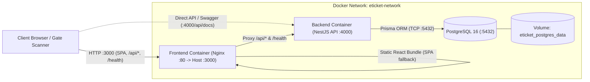
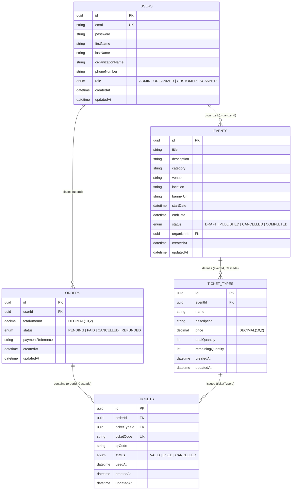
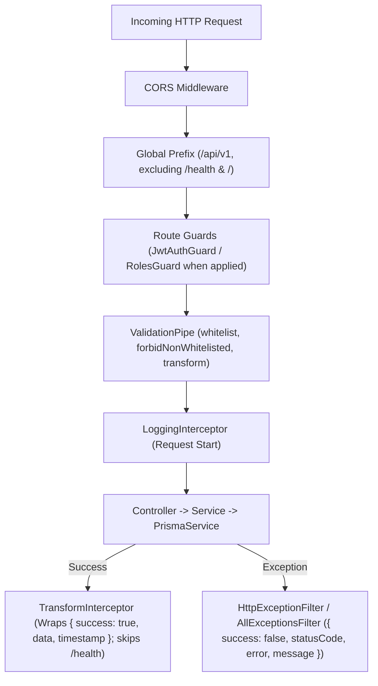
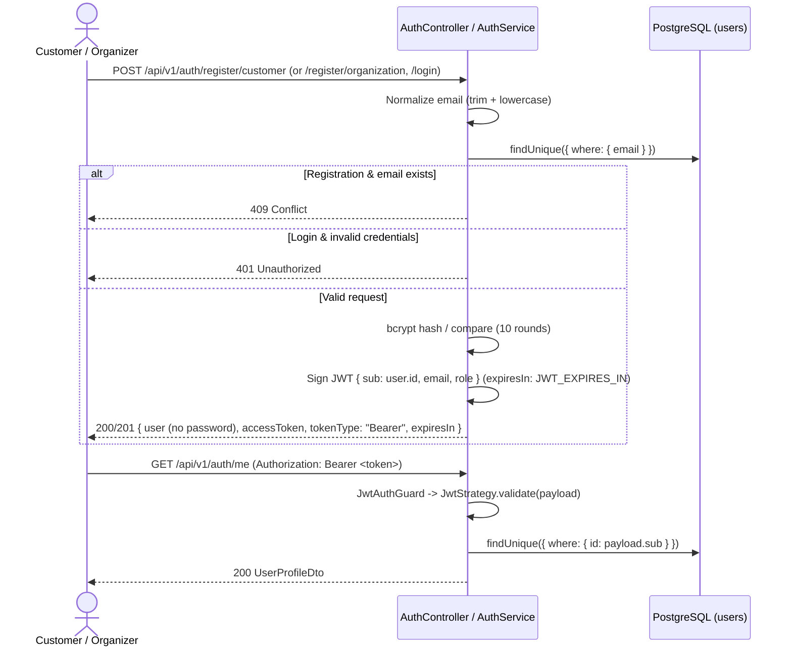
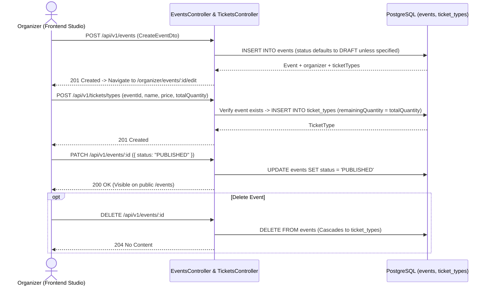
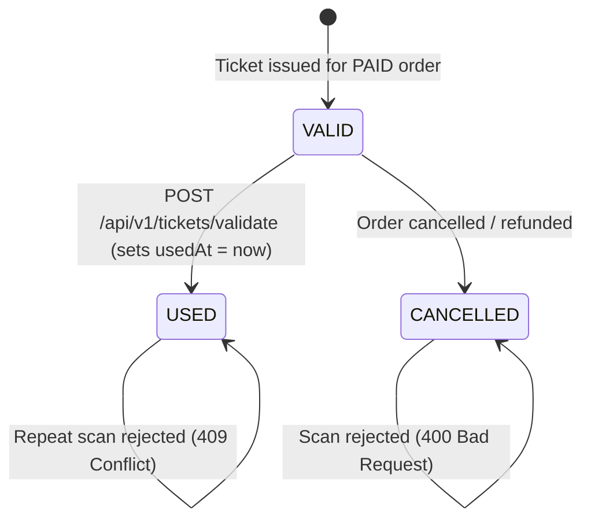
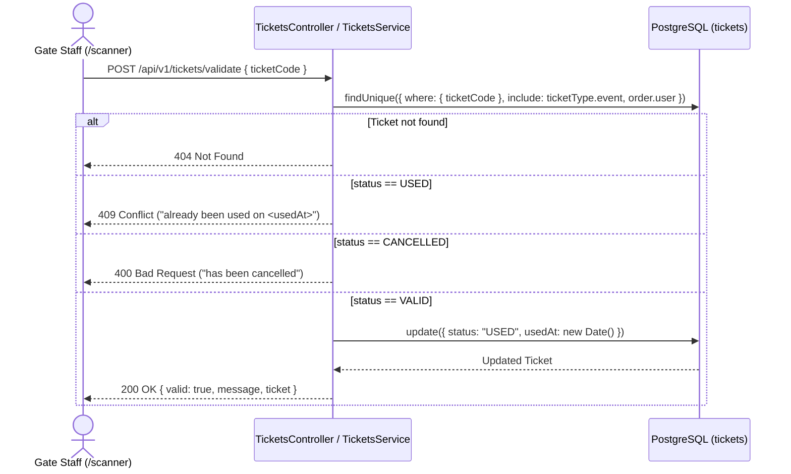
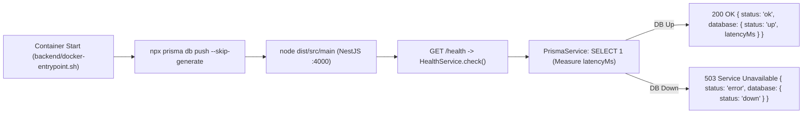

# System & Database Architecture — Universal E-Ticketing Platform

This document describes the end-to-end system architecture, database schema design, request-processing pipeline, and core application flows for the **Universal E-Ticketing Platform**, derived directly from the repository implementation (`frontend/`, `backend/`, `infra/`, and `docker-compose.yml`).

---

## 1. High-Level System Architecture

The platform follows a containerized **3-tier client-server architecture** connected over an isolated Docker bridge network (`eticket-network`):

- **Presentation Tier (`frontend/`)**: React 18 + TypeScript SPA built with Vite and React Router (`BrowserRouter`), served by **Nginx 1.27 Alpine** in production (or Vite Dev Server on port `5173` locally).
- **Application Tier (`backend/`)**: Modular **NestJS 10** REST API (TypeScript) exposing `/api/v1/*`, `/health`, and Swagger OpenAPI docs at `/api/docs`.
- **Data Tier (`postgres`)**: **PostgreSQL 16 Alpine** accessed exclusively through **Prisma ORM (`@prisma/client`)**, backed by a persistent volume (`eticket_postgres_data`).

### Runtime Environments

| Mode | Frontend Entry | Backend Entry | API Proxying |
|---|---|---|---|
| **Production (Docker Compose)** | `http://localhost:3000` (Nginx `:80`) | `http://localhost:4000` (`eticket-backend`) | Nginx proxies `/api/` and `/health` to `http://backend:4000` |
| **Local Development (Vite + Nest)** | `http://localhost:5173` (Vite Dev Server) | `http://localhost:4000` (`npm run start:dev`) | Vite dev proxy forwards `/api` and `/health` to `http://localhost:4000` |

---

## 2. Database Architecture & Schema Design

The database schema is defined in `backend/prisma/schema.prisma` using PostgreSQL as the primary relational store. All primary keys use **UUID v4** (`@default(uuid())`) to prevent sequential ID enumeration, and monetary values use fixed-precision **`DECIMAL(10, 2)`** to avoid floating-point rounding errors.

### 2.1 Entity-Relationship Diagram (ERD)

### 2.2 Table & Column Specification

#### `users` (Prisma model `User`)
Stores all platform accounts across customers, event organizers, gate scanners, and administrators.

| Column | Type | Constraints / Default | Notes |
|---|---|---|---|
| `id` | `UUID` | `PK`, `@default(uuid())` | Unique user identifier |
| `email` | `VARCHAR` | `UNIQUE`, `NOT NULL` | Normalized to lowercase during auth |
| `password` | `VARCHAR` | `NOT NULL` | Bcrypt hash (10 salt rounds); stripped from API profile responses |
| `firstName` | `VARCHAR` | Nullable | Given name |
| `lastName` | `VARCHAR` | Nullable | Family name |
| `organizationName` | `VARCHAR` | Nullable | Populated for `ORGANIZER` accounts |
| `phoneNumber` | `VARCHAR` | Nullable | Contact phone number |
| `role` | `Role` | `NOT NULL`, `@default(CUSTOMER)` | `ADMIN`, `ORGANIZER`, `CUSTOMER`, `SCANNER` |
| `createdAt` | `TIMESTAMP` | `@default(now())` | Record creation time |
| `updatedAt` | `TIMESTAMP` | `@updatedAt` | Auto-updated modification time |

#### `events` (Prisma model `Event`)
Stores event listings, schedules, venue metadata, and publishing lifecycle state.

| Column | Type | Constraints / Default | Notes |
|---|---|---|---|
| `id` | `UUID` | `PK`, `@default(uuid())` | Unique event identifier |
| `title` | `VARCHAR` | `NOT NULL` | Event title |
| `description` | `TEXT` | Nullable | Full event summary |
| `category` | `VARCHAR` | Nullable | E.g. `Conference & Music`, `Music`, `Sports` |
| `venue` | `VARCHAR` | `NOT NULL` | Venue name |
| `location` | `VARCHAR` | Nullable | City/country string |
| `bannerUrl` | `VARCHAR` | Nullable | Public banner image URL |
| `startDate` | `TIMESTAMP` | `NOT NULL` | Event start (ISO 8601) |
| `endDate` | `TIMESTAMP` | `NOT NULL` | Event end (ISO 8601) |
| `status` | `EventStatus` | `NOT NULL`, `@default(DRAFT)` | `DRAFT`, `PUBLISHED`, `CANCELLED`, `COMPLETED` |
| `organizerId` | `UUID` | `FK -> users.id`, `NOT NULL` | Owning organizer user |
| `createdAt` | `TIMESTAMP` | `@default(now())` | Record creation time |
| `updatedAt` | `TIMESTAMP` | `@updatedAt` | Auto-updated modification time |

#### `ticket_types` (Prisma model `TicketType`)
Defines pricing tiers and seat inventory per event. Deleted automatically when its parent event is deleted (`onDelete: Cascade`).

| Column | Type | Constraints / Default | Notes |
|---|---|---|---|
| `id` | `UUID` | `PK`, `@default(uuid())` | Unique tier identifier |
| `eventId` | `UUID` | `FK -> events.id` (`CASCADE`) | Parent event |
| `name` | `VARCHAR` | `NOT NULL` | Tier name (e.g., `VIP All-Access Pass`, `General Admission`) |
| `description` | `TEXT` | Nullable | Tier perks and inclusion summary |
| `price` | `DECIMAL(10, 2)` | `NOT NULL` | Ticket price in USD |
| `totalQuantity` | `INT` | `NOT NULL` | Initial allocated inventory |
| `remainingQuantity` | `INT` | `NOT NULL` | Remaining available tickets (initialized to `totalQuantity`) |
| `createdAt` | `TIMESTAMP` | `@default(now())` | Record creation time |
| `updatedAt` | `TIMESTAMP` | `@updatedAt` | Auto-updated modification time |

#### `orders` (Prisma model `Order`)
Tracks customer ticket purchases and payment settlement status.

| Column | Type | Constraints / Default | Notes |
|---|---|---|---|
| `id` | `UUID` | `PK`, `@default(uuid())` | Unique order identifier |
| `userId` | `UUID` | `FK -> users.id`, `NOT NULL` | Purchasing customer |
| `totalAmount` | `DECIMAL(10, 2)` | `NOT NULL` | Total order value |
| `status` | `OrderStatus` | `NOT NULL`, `@default(PENDING)` | `PENDING`, `PAID`, `CANCELLED`, `REFUNDED` |
| `paymentReference` | `VARCHAR` | Nullable | External payment reference (e.g., `KHQR-REF-998822`) |
| `createdAt` | `TIMESTAMP` | `@default(now())` | Record creation time |
| `updatedAt` | `TIMESTAMP` | `@updatedAt` | Auto-updated modification time |

#### `tickets` (Prisma model `Ticket`)
Represents individual issued digital passes tied to an order and a ticket tier. Deleted automatically when its parent order is deleted (`onDelete: Cascade`).

| Column | Type | Constraints / Default | Notes |
|---|---|---|---|
| `id` | `UUID` | `PK`, `@default(uuid())` | Unique ticket record ID |
| `orderId` | `UUID` | `FK -> orders.id` (`CASCADE`) | Parent order |
| `ticketTypeId` | `UUID` | `FK -> ticket_types.id`, `NOT NULL` | Tier granted by this ticket |
| `ticketCode` | `VARCHAR` | `UNIQUE`, `NOT NULL` | Human-readable & QR-encoded pass code (e.g., `TKT-2026-VIP-001`) |
| `qrCode` | `TEXT` | Nullable | Optional stored SVG/QR payload |
| `status` | `TicketStatus` | `NOT NULL`, `@default(VALID)` | `VALID`, `USED`, `CANCELLED` |
| `usedAt` | `TIMESTAMP` | Nullable | Exact check-in timestamp set on validation |
| `createdAt` | `TIMESTAMP` | `@default(now())` | Record creation time |
| `updatedAt` | `TIMESTAMP` | `@updatedAt` | Auto-updated modification time |

### 2.3 Seed Data Reference (`backend/prisma/seed.ts`)

Running `npm run prisma:seed` populates deterministic sample records for local testing:
- **Organizer**: `a0000000-0000-0000-0000-000000000001` (`organizer@eticket.com` / `Password123!`, role `ORGANIZER`)
- **Customer**: `a0000000-0000-0000-0000-000000000002` (`customer@eticket.com` / `Password123!`, role `CUSTOMER`)
- **Event**: `b0000000-0000-0000-0000-000000000001` (`Cambodia Tech Expo & Music Festival 2026`, `PUBLISHED`)
- **Ticket Tiers**: `VIP All-Access Pass` (`$99.00`, `199/200` left) and `General Admission` (`$25.00`, `1000/1000` left)
- **Order & Ticket**: Order `d0000000-0000-0000-0000-000000000001` (`PAID`, `KHQR-REF-998822`) with Ticket `TKT-2026-VIP-001` (`VALID`)

---

## 3. Application Layer Architecture

### 3.1 Backend Module Architecture (`backend/src/`)

`AppModule` composes configuration validation (`ConfigModule` + `env.validation.ts`), database connectivity (`PrismaModule` marked global), and domain feature modules:

- **`AuthModule`**: JWT Bearer authentication (`@nestjs/jwt`, `passport-jwt`), password hashing (`bcryptjs`), `JwtAuthGuard`, `RolesGuard`, `@Public()`, `@Roles()`, and `@CurrentUser()` decorators.
- **`EventsModule`**: Event CRUD (`POST /events`, `GET /events`, `GET /events/:id`, `PATCH /events/:id`, `DELETE /events/:id`) with category/status query filtering.
- **`TicketsModule`**: Ticket tier creation & lookup (`POST /tickets/types`, `GET /tickets/types/event/:eventId`), ticket inspection (`GET /tickets/:code`), and single-entry validation (`POST /tickets/validate`).
- **`HealthModule`**: `GET /health` database readiness probe (`SELECT 1` latency measurement via `PrismaService.checkHealth()`).

#### NestJS Request & Response Pipeline (`backend/src/main.ts`)

### 3.2 Frontend Application Architecture (`frontend/src/`)

The frontend is a **React 18 + TypeScript** SPA using `BrowserRouter` for clean, hash-free URLs and solid high-contrast surfaces (`src/index.css`):

| Route | Page Component | Purpose & Backend Endpoints Used |
|---|---|---|
| `/` | `HomePage` | Hero overview, live event metrics, featured events, quick ticket lookup (`GET /api/v1/events`) |
| `/events` | `EventsPage` | Searchable & filterable catalog (`GET /api/v1/events?status=`) |
| `/events/:id` | `EventDetailPage` | Event details, organizer info, tier availability (`GET /api/v1/events/:id`, `GET /api/v1/tickets/types/event/:eventId`) |
| `/tickets`, `/tickets/:code` | `TicketLookupPage` | Digital pass lookup + QR rendering (`qrcode.react`) (`GET /api/v1/tickets/:code`) |
| `/scanner` | `ScannerPage` | Gate check-in scanner with optional `BarcodeDetector` camera mode (`POST /api/v1/tickets/validate`) |
| `/organizer` | `OrganizerDashboardPage` | Organizer KPIs, status switching, delete confirmation (`GET`, `PATCH`, `DELETE /api/v1/events`) |
| `/organizer/events/new`, `/organizer/events/:id/edit` | `EventFormPage` | Create/edit events and create ticket tiers (`POST`/`PATCH /api/v1/events`, `POST /api/v1/tickets/types`) |
| `/status` | `SystemStatusPage` | Live API & PostgreSQL health/latency view (`GET /health`) |

All requests pass through `frontend/src/services/api.ts`, which automatically unwraps `{ success: true, data }` envelopes, handles `204 No Content`, and converts backend error payloads into typed `ApiError` instances.

---

## 4. Core End-to-End Flows

### 4.1 Authentication & Profile Flow (JWT Bearer)

### 4.2 Organizer Event & Ticket Tier Management Flow

### 4.3 Ticket Pass Lookup & Gate Check-In Validation Flow

The gate check-in flow prevents duplicate entry by checking `TicketStatus` and atomically transitioning `VALID` tickets to `USED` with a `usedAt` timestamp.

### 4.4 Health Check & Startup Synchronization Flow

---

## 5. Security, Validation & CI/CD Controls

- **Environment Validation (`backend/src/config/env.validation.ts`)**: Fails fast at startup if `DATABASE_URL` is missing or `NODE_ENV`/`PORT` types are invalid.
- **Strict Payload Whitelisting**: Global `ValidationPipe` enforces `whitelist: true` and `forbidNonWhitelisted: true`, rejecting unknown JSON properties before they reach services.
- **Credential & Role Protection**: Passwords are hashed with `bcryptjs` (`saltRounds = 10`) and excluded from `AuthService.toUserProfile()` and Prisma `select` projections; `JwtAuthGuard` and `RolesGuard` enforce token verification and RBAC (`ADMIN`, `ORGANIZER`, `CUSTOMER`, `SCANNER`).
- **Container Hardening**: `backend/Dockerfile` runs under the unprivileged `node` user; `infra/nginx/nginx.conf` handles gzip compression, static asset caching, SPA fallback, and internal `/api/` + `/health` proxying.
- **Automated CI (`.github/workflows/ci.yml`)**: Every push/PR to `main`, `master`, `feat/**`, and `dev-*` runs `backend-ci` (build, unit tests, Prisma push, E2E tests against PostgreSQL 16), `frontend-ci` (`tsc -b --noEmit` + Vite build), and `docker-ci` (full Compose build and live `/health` + Nginx proxy verification).
